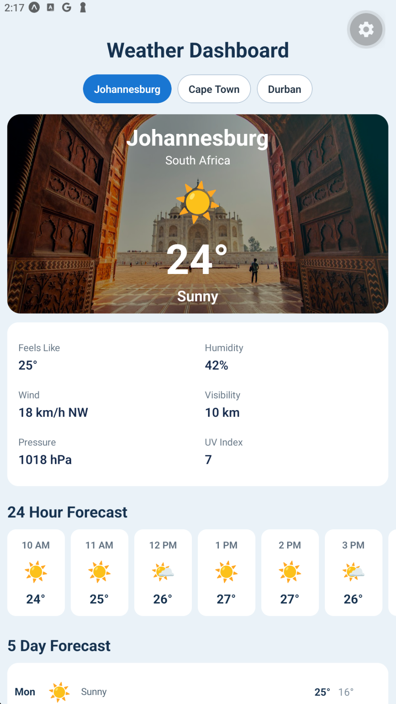
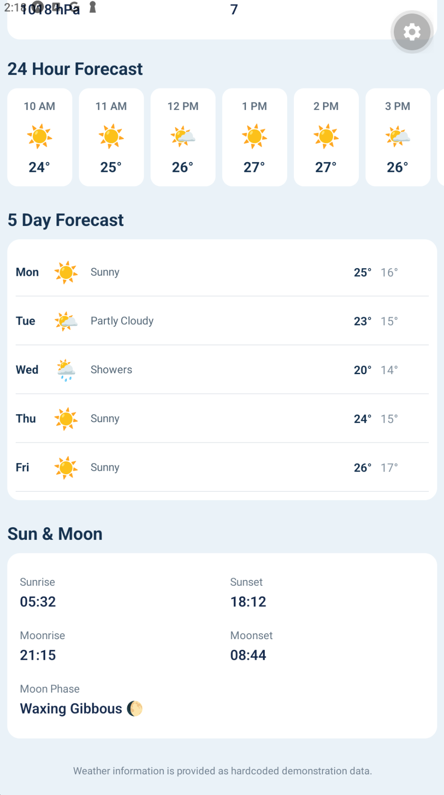
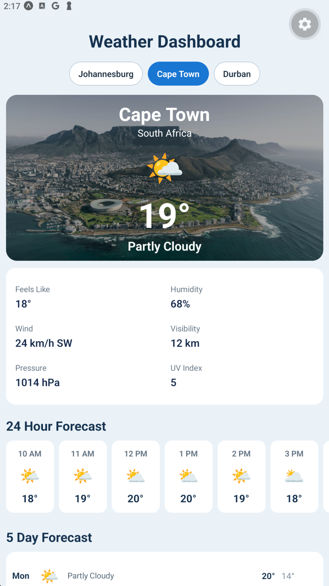
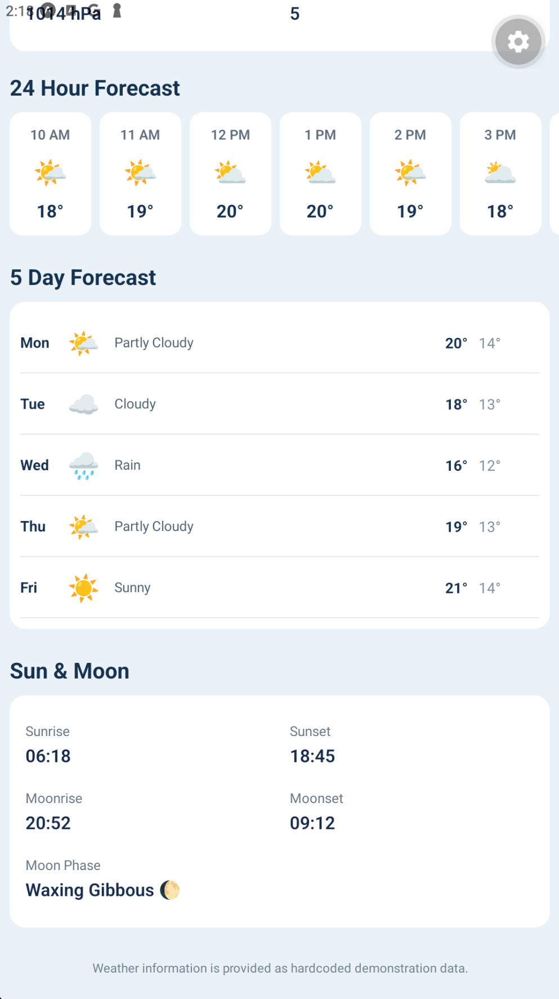
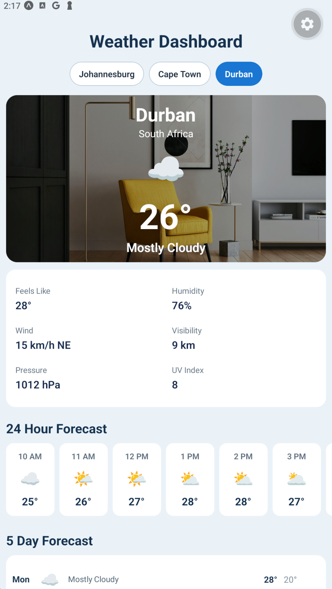
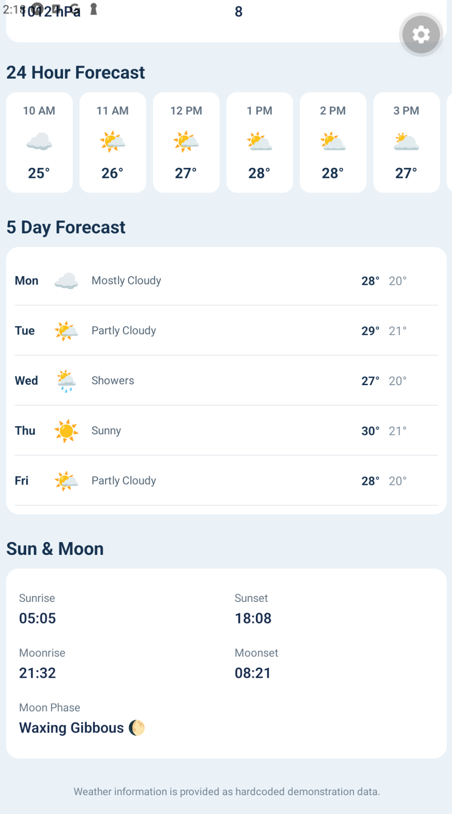

# Weather Dashboard

Name: Zain Alli

Student Number: ST10519974

GitHub Repository Link: https://github.com/ST10519974/MAST_ICE-TASK

## 1. Introduction

The Weather Dashboard is a mobile application built with Expo, React Native and TypeScript. It displays hardcoded weather information for three South African cities: Johannesburg, Cape Town and Durban. The user selects a city with the buttons at the top of the screen, and the whole dashboard updates to show that city's weather.

The dashboard contains:

- A hero section with the city name, country, weather icon, current temperature, condition and a background image
- A grid of current conditions (feels like, humidity, wind, visibility, pressure and UV index)
- A scrollable 24-hour forecast
- A 5-day forecast showing the day, icon, condition, high and low
- A Sun & Moon section (sunrise, sunset, moonrise, moonset and moon phase)

The supplied code contained a number of errors that stopped the interface from displaying correctly. This document explains each one and how it was corrected.

## 2. Development Environment

| Item | Details |
| --- | --- |
| Framework | Expo |
| UI library | React Native |
| Language | TypeScript |
| Operating environment | Institutional VM |
| Emulator | BlueStacks 5 |
| Test client | Expo Go |
| Editor | Visual Studio Code |

## 3. Error Log

Each correction is marked in `App.tsx` with a comment in the form `FIX #n`, matching the numbers below.

| # | Location | Problem | Error Type | Correction |
| --- | --- | --- | --- | --- |
| 1 | `App.tsx` – import statement | `ImageBackground` is used in the hero section but was never imported from `react-native`. React Native cannot find the component, so the app fails with a compile/runtime error as soon as the screen renders. | Import error | Added `ImageBackground` to the `react-native` import list. |
| 2 | `App.tsx` – city button style and text style | The "selected" check compared `selectedCity` with `weather.country` (always "South Africa") instead of `weather.city`. The comparison could never be true, so no city button was ever highlighted. | Logic / state error | Changed both comparisons to `selectedCity === weather.city`, so the active button gets the blue selected style and white text. |
| 3 | `App.tsx` – city button `onPress` | `onPress` called `setSelectedCity(weather.country)`. This stored "South Africa" in state, and `weatherData.find()` looks for a matching city name, so it found nothing and the app switched to the "Weather information unavailable" screen. City selection was effectively broken. | State / data selection error | Changed it to `setSelectedCity(weather.city)`, so the stored value matches the `city` field used by `find()`. |
| 4 | `App.tsx` – `ImageBackground` `source` | `source` was given the plain string `backgroundImage`. React Native requires a remote image to be an object of the form `{ uri: '...' }`, so the hero image would not load. | Component property / image error | Changed to `source={{ uri: selectedWeather.backgroundImage }}`. |
| 5 | `App.tsx` – Humidity detail | The Humidity item displayed `selectedWeather.feelsLike` followed by `%`, so it showed the feels-like temperature as the humidity. The data was read from the wrong object property. | Wrong data / object property | Changed it to `selectedWeather.humidity`. |
| 6 | `App.tsx` – 24-hour forecast `ScrollView` | `horizontal={false}` made the hourly forecast a vertical list of 24 cards inside the page, which also conflicts with the horizontal card layout and horizontal-scroll settings around it. The user could not swipe through the hours as intended. | Component property / scrolling error | Changed it to `horizontal` so the hourly cards sit side by side and scroll sideways. |
| 7 | `App.tsx` – hourly temperature | Each hour card displayed `selectedWeather.temperature` (the current temperature) instead of that hour's temperature, so every card showed the same number. | Wrong data / object property | Changed it to `hour.temperature` so each card shows its own value. |
| 8 | `App.tsx` – 5-day forecast `map()` | The `map()` callback used curly braces `{ }` but contained no `return`, so it returned `undefined` for every day. The JSX was only an unused expression, so no forecast days were rendered at all. | Array rendering / syntax error | Replaced the braces with parentheses `( )` so the callback implicitly returns the JSX for each day. |
| 9 | `App.tsx` – 5-day forecast temperatures | The high temperature style displayed `day.low` and the low temperature style displayed `day.high`, so the two values were swapped. | Wrong data / object property | Swapped them so `highTemperature` shows `day.high` and `lowTemperature` shows `day.low`. |
| 10 | `App.tsx` – 5-day forecast row order | The condition text was placed after the temperatures. The condition style uses `flex: 1` to fill the remaining row space, and the required order is day, icon, condition, high, low. | Layout / component order | Moved the condition `Text` to sit before the temperatures `View`. |
| 11 | `App.tsx` – Sun & Moon, Sunrise | The Sunrise item displayed `selectedWeather.sunset`, so sunrise and sunset showed the same time. | Wrong data / object property | Changed it to `selectedWeather.sunrise`. |
| 12 | `App.tsx` – `WeatherDetail` component | The component destructured `value` but rendered `{label}` in the value `Text`. Every detail card (feels like, wind, pressure, sunrise, etc.) showed its label twice and never its value. | Component / props error | Changed the value `Text` to render `{value}`. |
| 13 | `App.tsx` – styles: `weatherHero` | The hero height was `170`, too small for the city name, country, icon, temperature and condition stacked together. Because the container uses `overflow: 'hidden'`, content was clipped at the top and bottom. | Style / dimensions error | Increased the height to `270` so all the hero text fits. |
| 14 | `App.tsx` – styles: `heroOverlay` | The overlay colour was `rgba(0, 0, 0, 0.05)`, which is almost transparent. White text on a bright sky photo was hard to read. | Style / colour error | Changed it to `rgba(0, 0, 0, 0.35)` for a readable contrast. |
| 15 | `App.tsx` – styles: `detailItem` and `sunMoonCard` | `detailItem` had `width: '100%'`, so each detail took a full row and the six current-condition items formed one long column. The container's `flexWrap` and `space-between` settings show a grid was intended. `sunMoonCard` also had no row layout. | Style / layout / spacing error | Set `detailItem` to `width: '48%'` for a two-column grid, and gave `sunMoonCard` `flexDirection: 'row'`, `flexWrap: 'wrap'` and `justifyContent: 'space-between'`. |
| 16 | `App.tsx` – styles: `dailyCard` | `flexDirection` was `'column'`, which stacked the day, icon, temperatures and condition vertically. The fixed widths on the child styles (45, 45, 90) and `flex: 1` on the condition are designed for a single horizontal row per day. | Style / layout / alignment error | Changed it to `flexDirection: 'row'` and added `alignItems: 'center'`. |

## 4. Testing

The corrected application is tested in Expo Go running on BlueStacks 5, using the following scenarios.

- **Initial launch:** The app starts without errors, the dashboard appears with Johannesburg selected, and the Johannesburg button is highlighted.
- **City selection:** Each of Johannesburg, Cape Town and Durban is selected in turn. The city name, current temperature, condition, icon, background image, current-condition grid, hourly forecast, 5-day forecast and Sun & Moon times all change to match the selected city.
- **Current conditions:** Humidity, wind, visibility, pressure and UV index each show their own values.
- **24-hour forecast:** All 24 hourly cards are present, each with a time, icon and its own temperature, and the list scrolls horizontally.
- **5-day forecast:** Five days are shown for every city, each with day, icon, condition, high and low, and the high is greater than the low.
- **Sun & Moon:** Sunrise, sunset, moonrise, moonset and moon phase are all displayed, and sunrise differs from sunset.
- **Complete interface:** The whole page is scrolled from top to bottom to confirm every section is visible and the layout fits the emulator screen.

## 5. Screenshot

The screenshots below show the completed Weather Dashboard running inside the BlueStacks 5 emulator using Expo Go. Two screenshots are included for each city to show the full interface.

### Johannesburg

### Cape Town

### Durban

## 6. Conclusion

Debugging this application showed me that a program can run and still be wrong. Some errors, such as the missing `ImageBackground` import and the `map()` with no `return`, stopped parts of the interface from appearing, while others, such as the swapped high and low temperatures, the humidity reading `feelsLike`, and the sunrise showing the sunset time, only became obvious when I compared the screen with the data. The city selection bug taught me how state and data lookup depend on each other: storing the country instead of the city made the `find()` call fail. I also learned how much layout properties such as `flexDirection`, `width`, `height` and `horizontal` affect what the user actually sees. Finally, working through the code methodically and recording each fix made me think about why each problem occurred, not just how to correct it.
